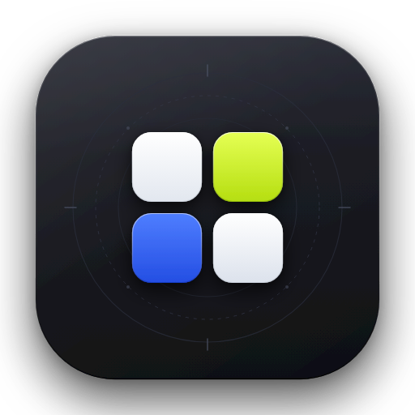

<div align="center">

<picture>
  <source media="(prefers-color-scheme: dark)" srcset="assets/logo-dark.png">
  <source media="(prefers-color-scheme: light)" srcset="assets/logo-light.png">
  
</picture>

# AutoMarket Studio

**A local-first, privacy-focused marketing and client intelligence desktop application for solo software engineers, consultants, and independent developers.**

[](LICENSE)
[](https://www.typescriptlang.org/)
[](https://www.electronjs.org/)
[](https://react.dev/)
[](https://tailwindcss.com/)
[](#privacy-and-local-first-guarantee)
[](#model-context-protocol-mcp-server)

<br />

[About](#about) • [Core Features](#core-features) • [Agentic Skills](#agentic-skills-for-automated-marketing) • [MCP Server](#model-context-protocol-mcp-server) • [Getting Started](#getting-started) • [Contributing](#contributing)

</div>

---

## About

Most marketing software is built for sales teams managing thousands of cold email sequences. If you are an independent software engineer or technical consultant, that approach usually burns credibility and wastes time.

AutoMarket Studio takes a different approach: it turns your past engineering results into inbound client conversations. Instead of sending generic pitch templates, you use concrete website performance audits, Core Web Vitals diagnostics, and real architectural case studies.

The application runs entirely on your local machine using Electron, React, and local file storage. There are no cloud user accounts, no tracking cookies, and no monthly SaaS subscription requirements. Your target client data stays private on your disk.

### Repository Topics & Discovery Tags
`electron` • `react` • `typescript` • `mcp-server` • `local-first` • `model-context-protocol` • `marketing-automation` • `crm` • `tailwind-css` • `desktop-app` • `apple-hig` • `offline-first` • `freelance-tools` • `claude-desktop` • `cursor-ide` • `antigravity`

---

## Key Design Principles

1. **Strictly Local-First**: All prospect records, notes, and publishing schedules live in `leads/leads.json` on your machine.
2. **Clear Technical Copy**: No sales jargon or AI buzzwords. Every message cites concrete technical issues, such as slow mobile response times or broken checkout forms.
3. **15-Minute Daily Routine**: A four-step morning workflow helps you review inquiries, approve a case study post, and send tailored performance notes before your workday starts.
4. **Apple Desktop Guidelines**: Built with frameless window management, keyboard navigation (`1-7`, `Cmd/Ctrl+K`, `Escape`), minimum 12px typography, and tactile spring motion.
5. **Dual Theme Support**: Switch seamlessly between Obsidian Slate (dark mode) and Silver Daylight (light mode).

---

## Core Features

### 1. Studio Hub
Your daily marketing workspace. Tracks weekly audience reach curves, calendar post schedules, daily focus time, and quick triggers to write a new post or review a lead.

### 2. Lead Radar and Local CRM
A private offline prospect database scored by website performance health:
* **Critical Gaps**: Sites with slow mobile loading (>4s), high checkout drop-offs, or outdated plugins.
* **Modernization Opportunities**: Stable businesses with high traffic whose frontend architecture is ready for an upgrade.
* **Healthy Systems**: Well-maintained sites with low optimization urgency.

### 3. Client Opportunities and Inbound Intent Stream
Monitors public discussions across social networks (such as X/Twitter and Bluesky). When a founder or director posts about a slow patient portal or e-commerce checkout friction, the studio matches the request with your relevant past project and prepares a natural, suggested reply.

### 4. Content Studio and Scheduled Queue
Compose, format, and preview technical case studies with live character counting for Bluesky, X, LinkedIn, and developer blogs. Posts can be queued for specific publishing windows or saved as local drafts.

### 5. Two-Page Modernization Audit Report
Produces a structured performance review for any prospective client:
* Mobile speed diagnostics with before-and-after benchmarks.
* Estimated conversion and revenue impact from mobile latency.
* Recommended engineering steps (such as edge caching, image optimization, or static migration).

### 6. Daily 15-Minute Marketing Sprint
A guided morning routine:
1. Approve today's technical case study update.
2. Review and send the top matched client message.
3. Queue an e-commerce checkout optimization summary.
4. Review your local CRM pipeline.

### 7. Growth and Revenue Attribution
Tracks your marketing metrics from cold website audits to signed development contracts, including average sales cycle lengths and top-performing case studies.

---

## Agentic Skills for Automated Marketing

When running AutoMarket Studio alongside an AI assistant (such as Google Antigravity, Claude Code, or Cursor), the app uses specialized skills to carry out marketing tasks:

| Skill | Purpose and Application |
| :--- | :--- |
| **`scrapling-official`** | **Web Scraping and Performance Auditing**: Crawls prospective client websites, extracts page structures, measures mobile load speed, and identifies checkout bottlenecks without triggering anti-bot hurdles. Powers the Lead Radar and Audit Report generator. |
| **`last30days`** | **Inbound Intent Discovery**: Searches public discussions across X/Twitter, Bluesky, Reddit, and Hacker News for founders seeking senior developers or performance fixes within the last 30 days. |
| **`playwright-cli`** | **Headless Browser Proofs**: Controls headless Chromium to capture high-resolution mobile screenshots and test responsive layouts for client audit attachments. |
| **`humanizer`** | **Natural Voice and Clarity**: Reviews suggested messages and social posts to remove repetitive AI patterns, sales clichés, and buzzwords, keeping every message direct and professional. |
| **`automation`** | **Daily Morning Routine Scheduler**: Manages background cron triggers to prepare your daily post draft and top client inquiries every morning at 9:00 AM. |

---

## Model Context Protocol (MCP) Server

AutoMarket Studio includes a native **Model Context Protocol (MCP)** server on `stdio`. External coding agents such as **Claude Desktop**, **Cursor IDE**, **Google Antigravity**, and **OpenClaw** can query your local pipeline and perform tasks directly.

### Start the MCP Server
```bash
npm run mcp
```

### Client Configurations

#### Claude Desktop (`claude_desktop_config.json`)
```json
{
  "mcpServers": {
    "automarket-studio": {
      "command": "node",
      "args": ["<path-to-repository>/mcp/server.js"]
    }
  }
}
```

#### Cursor IDE (`.cursor/mcp.json`)
```json
{
  "mcpServers": {
    "automarket": {
      "command": "node",
      "args": ["<path-to-repository>/mcp/server.js"]
    }
  }
}
```

### The 11 Native MCP Tools

| Tool | Parameters | Description |
| :--- | :--- | :--- |
| `list_leads` | `status`, `search`, `limit`, `offset` | Query local prospects with health scores, flaw filters, and pagination. |
| `get_lead_audit` | `leadIdOrDomain` | Retrieve full speed audit, contact information, and revenue friction points. |
| `update_lead` | `leadId`, `status`, `notes` | Update prospect status (`New`, `Audited`, `Proposal Sent`, `Closed`). |
| `get_content_queue` | `status` | Inspect scheduled posts and saved drafts. |
| `schedule_post` | `title`, `content`, `channel`, `time`, `isDraft` | Add a case study or technical tip to the publishing queue. |
| `publish_post` | `postIdOrTitle` | Publish a queued update and advance Daily Sprint Step 1. |
| `get_client_opportunities`| `minScore` | Query live buyer requests and matched pain points. |
| `get_daily_sprint` | *None* | Read current marketing sprint progress and completion status. |
| `complete_sprint_step` | `stepNumber` | Mark a specific daily routine step as complete. |
| `generate_client_proposal`| `leadIdOrDomain`, `packageType` | Generate a clear, plain English message addressing a specific website gap. |
| `export_leads_csv` | *None* | Generate a local timestamped CSV backup to `leads/leads_backup.csv`. |

---

## In-App AI Engine Selector

You can change your active AI provider in **Studio Preferences** or directly within the post composer and proposal modals:
* **Google Antigravity**: Native macro-planning and deep reasoning assistant.
* **Claude (Anthropic)**: Direct API integration for nuanced, clear writing.
* **Ollama (100% Local Offline)**: Runs on `http://localhost:11434` with `llama3.2` or `mistral` with zero external network requests.
* **OpenAI / Codex**: Cloud API integration for quick drafting.

---

## Privacy and Local-First Guarantee

AutoMarket Studio ships with an example template (`leads/leads.example.json`). Your actual prospect pipeline is stored locally in:

```
leads/leads.json
```

* **Git-Ignored by Default**: `leads/leads.json` is listed in `.gitignore` and is never committed or pushed to GitHub.
* **Zero Cloud Lock-in**: Your prospect lists, client notes, and draft schedules stay on your physical hard drive in standard JSON format.
* **One-Click Local Backups**: Export your entire database to CSV at any time via the bottom dock workspace menu.

---

## Getting Started

### Prerequisites
* [Node.js](https://nodejs.org/) (v18.0 or higher)
* npm or pnpm

### 1. Clone and Install
```bash
git clone https://github.com/1-Pankaj/AutonomousMarketing.git
cd AutonomousMarketing
npm install
```

### 2. Start Development App
```bash
npm run dev
```
This starts the Vite development server and launches the Electron desktop application.

### 3. Customize Your Profile
1. Press `6` or click the gear icon to open **Studio Preferences**.
2. Enter your name, specialty (e.g., *Full-Stack Web Optimization Specialist*), and connected channels.
3. Preferences are saved automatically to your local machine.

---

## Keyboard Shortcuts

| Key | Action |
| :--- | :--- |
| `1` | Open **Studio Hub** |
| `2` | Open **Content Studio** |
| `3` | Open **Lead Radar** |
| `4` | Open **Client Opportunities** |
| `5` | Open **Growth Analytics** |
| `6` | Open **Studio Preferences** |
| `7` | Open **Daily 15-Minute Sprint** |
| `Cmd` / `Ctrl` + `K` | Open Command Search |
| `Escape` | Dismiss open modals, popovers, or sheets |

---

## Development and Testing

```bash
# Type check TypeScript
npm run lint

# Run Playwright visual and behavioral E2E tests
npm run test:e2e

# Build production distribution
npm run build
```

---

## Contributing

We welcome contributions from developers, designers, and solo founders. Please review [CONTRIBUTING.md](CONTRIBUTING.md) for architectural guidelines, Apple Human Interface standards, and pull request steps.

---

## License

AutoMarket Studio is open-source software licensed under the [MIT License](LICENSE).
